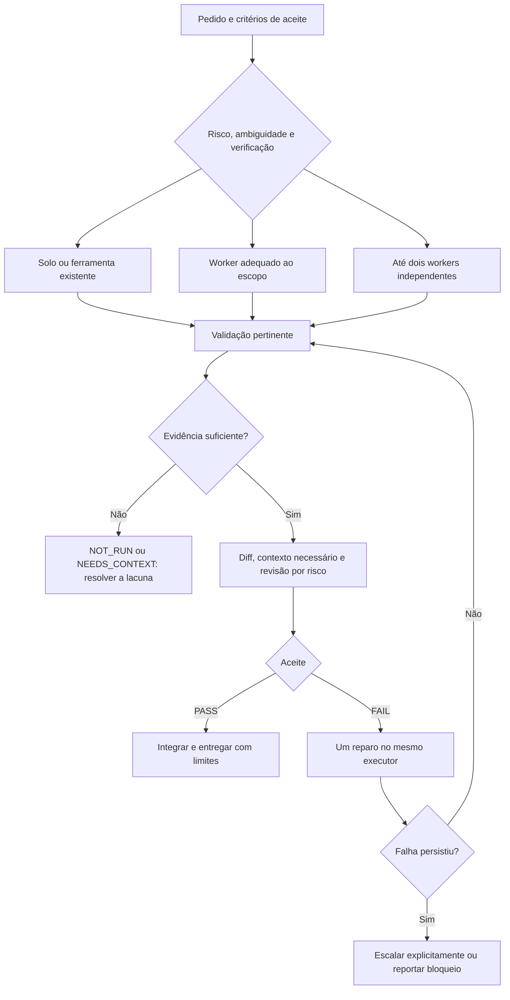

<p align="center">
  
</p>

<h1 align="center">Enxame</h1>
<p align="center"><strong>O agente certo. O esforço necessário. Evidência antes do aceite.</strong></p>
<p align="center">Orquestração adaptativa para Codex, Claude Code, Hermes Agent e Antigravity.</p>

<p align="center">
  <a href="https://github.com/playertwo1/enxame/actions/workflows/checks.yml"></a>
  <a href="LICENSE"></a>
  
</p>

<p align="center">
  <a href="#comece-em-poucos-passos">Instalação</a> ·
  <a href="#como-o-enxame-decide">Roteamento</a> ·
  <a href="#revisão-com-evidência">Validação</a> ·
  <a href="#o-que-a-pesquisa-sustenta">Pesquisa</a> ·
  <a href="#validar-o-projeto">Testes</a>
</p>

## Por que usar

Uma tarefa simples pode ser resolvida diretamente. Uma investigação independente pode compensar um executor econômico. Uma mudança de autorização pode exigir um modelo mais capaz desde o início, mesmo que altere uma única linha.

O **Enxame** é uma skill com procedimentos operacionais (SOPs) e helpers locais para tomar essas decisões, dividir responsabilidades e conferir entregas. O objetivo é reduzir o **custo total por tarefa aceita**, preservando correção e segurança.

- **Solo é uma opção completa.** Não crie agentes quando coordenação e revisão custarem mais que o trabalho.
- **Capacidade acompanha o risco.** Escolha modelo e esforço conforme ambiguidade e facilidade de verificação.
- **Paralelismo tem fronteiras.** Cada worker recebe arquivos próprios; uma pessoa/agente mantém o plano e integra a entrega.
- **Revisão começa pelo diff.** Consulte contratos, callers e testes quando necessários.
- **Resultados têm evidência.** `PASS`, `FAIL` e `NOT_RUN` têm significados distintos.

O Enxame orienta o agente hospedeiro. Não é um daemon, proxy de APIs ou motor autônomo de roteamento; não configura assinaturas, modelos ou credenciais. O uso depende das ferramentas e permissões disponíveis no seu ambiente.

## Comece em poucos passos

**Pré-requisitos dos helpers:** Git e Windows com PowerShell 5.1 ou PowerShell 7. A skill em Markdown pode ser copiada em outros sistemas; os scripts desta versão foram verificados no Windows.

```powershell
git clone https://github.com/playertwo1/enxame.git
Set-Location enxame

# Confira os destinos sem gravar arquivos.
./scripts/install.ps1 -Target All -WhatIf

# Instale nos quatro agentes.
./scripts/install.ps1 -Target All
```

Escolha um agente com `-Target Codex`, `Claude`, `Hermes` ou `Antigravity`. Se a política local bloquear scripts, revise o arquivo e use uma execução autorizada para o processo, por exemplo `powershell -NoProfile -ExecutionPolicy Bypass -File ./scripts/install.ps1 -Target Codex`; não é preciso mudar a política global.

| Destino | Pasta instalada no perfil do usuário |
|---|---|
| Codex | `~/.codex/skills/enxame/` |
| Claude Code | `~/.claude/skills/enxame/` |
| Hermes Agent | `~/.hermes/skills/enxame/` |
| Antigravity App/IDE | `~/.gemini/config/skills/enxame/` |
| Compatibilidade Antigravity | `~/.gemini/antigravity/skills/enxame/` |

O instalador copia somente a skill e seus recursos de execução. Não copia `.git`, testes ou imagens do README e não altera configurações de provedores. Antes de atualizar um destino existente, guarda sua cópia completa em `~/.enxame-backups/<execução>/<agente>/`. Confere SHA-256 dos arquivos copiados, preserva arquivos extras e retorna `UNCHANGED` quando o payload já coincide. Junctions e links de redirecionamento são recusados para evitar escrita fora dos destinos esperados.

**Hermes com perfil personalizado ou instalação Windows:** o diretório efetivo pode ser diferente de `~/.hermes`, por exemplo `%LOCALAPPDATA%/hermes`. Consulte o próprio CLI e informe o diretório encontrado; isso não altera o perfil ativo:

```powershell
$hermesHome = Split-Path -Parent (hermes config path)
./scripts/install.ps1 -Target Hermes -HermesHome $hermesHome
```

**Recarregue as skills ou abra uma nova sessão do agente.** Instalação por arquivos não comprova descoberta ou execução dentro do aplicativo. O [guia por harness](references/harnesses.md) explica as diferenças, incluindo o caminho separado do Antigravity CLI, que este instalador não configura.

Para atualizar, faça `git pull --ff-only` no clone e execute o instalador novamente. Para restaurar uma instalação anterior, feche a sessão afetada e restaure a pasta daquele agente a partir do backup correspondente; os backups ficam fora dos diretórios de descoberta de skills.

### Primeiro pedido

No Codex:

```text
Use $enxame para corrigir este bug. Escolha execução direta ou delegada,
registre o modelo/esforço efetivos e valide o comportamento alterado.
```

Nos demais agentes:

```text
Use a skill enxame para implementar esta tarefa. Comece econômico quando
o risco e a verificação permitirem; escale por evidência, com arquivos
separados por worker e revisão proporcional ao impacto.
```

O nome da ferramenta e a possibilidade de controlar o modelo variam por harness. O [SKILL.md](SKILL.md) é a política comum; o adaptador não deve inventar ferramentas nem alegar que selecionou um modelo que o host não permite observar.

## Como o Enxame decide

São quatro escolhas independentes: **delegar**, **selecionar modelo**, **definir esforço** e **paralelizar**. Número de linhas e arquivos ajuda a estimar volume; risco e ambiguidade determinam o cuidado necessário.

| Trabalho | Ponto de partida | Evidência e escalada |
|---|---|---|
| Typo, edição mecânica ou comando conhecido | Solo ou ferramenta existente | Diff e checagem pertinente; reavaliar se surgir efeito funcional. |
| Busca ou extração delimitada | Econômico/baixo, se delegar compensar | Referências recuperáveis e amostra conferida; escalar diante de omissão demonstrada. |
| Bug local reproduzível | Econômico/baixo ou médio | Teste da falha e contexto suficiente; escalar se persistir erro de raciocínio. |
| Contratos entre módulos | Intermediário ou forte | Callers, tipos e verificações de integração afetadas. |
| Autorização, dinheiro, migração destrutiva | Forte desde o início quando o dano justificar | Verificação independente proporcional ao risco. |
| Frentes separáveis | Até dois workers inicialmente | Ownership exclusivo e conferência da integração. |

`econômico`, `intermediário` e `forte` são aliases de capacidade/custo a mapear para o catálogo disponível. Não são IDs de modelos. Registre **provedor, API/harness, modelo e esforço efetivos**; quando não expostos, informe essa limitação.

Mais esforço não equivale automaticamente a um modelo maior, e os níveis não são universais entre provedores. Não há obrigação de percorrer todas as etapas da escada. Falta de contexto exige informação; erro de ambiente exige diagnóstico. Uma quota excedida não se resolve aumentando raciocínio.

Após uma reprovação, permita um reparo no mesmo executor. Se a falha persistir, interrompa a repetição e escolha uma escalada explícita ou reporte o impedimento. Esgotar tentativas não autoriza aprovar um defeito. Veja a [matriz completa](references/routing.md).



## Revisão com evidência

O coletor reúne alterações staged, unstaged e untracked sem executar `git add` nem modificar o index. Repositórios ainda sem commit inicial também são cobertos. Lockfiles, SVGs e outras categorias não são descartados por extensão.

Execute a partir do repositório que será revisado, apontando para o helper instalado ou para seu clone:

```powershell
$collector = Join-Path $HOME '.codex/skills/enxame/scripts/enxame-diff.ps1'

# Sem comando: a saída informa VALIDATION: NOT_RUN.
& $collector -Paths 'src', 'tests'

# Somente um comando de validação confiável escolhido pelo operador.
& $collector -VerifyCommand 'npm test' -Paths 'src', 'tests'

# Comparar o estado de trabalho com uma revisão específica.
& $collector -BaseRef 'origin/main' -Paths 'src'
```

Os caminhos são literais e relativos à raiz do repositório. Use `-Paths` para limitar o material da tarefa e preserve o estado inicial de mudanças concorrentes. Sem `-BaseRef`, o baseline é HEAD; sem HEAD, o coletor apresenta patches staged e unstaged em sequência. Não escolha um baseline posterior às mudanças que pretende revisar.

```text
HEAD: <commit ou UNBORN>
BASE: <commit ou EMPTY_TREE>
VALIDATION: PASS | FAIL | NOT_RUN
PATCH_SHA256: <sha256 da base, status e patch completo>
--- STATUS ---
...
--- PATCH ---
...
REVIEW: COLLECTED (binary content requires separate inspection)
```

O hash inclui os binários; seu payload é omitido da saída textual e exige inspeção própria. Arquivos ignorados pelo Git ficam fora da coleta. Links untracked exigem revisão separada. Não há detector automático de segredos: confira o escopo e o conteúdo antes de enviar a saída a um modelo.

**Saída zero significa coleta concluída.** Não transforma `NOT_RUN` em teste aprovado, nem representa aceite visual ou funcional. Se a validação falhar, seu código de saída é propagado; uma falha Git interrompe a coleta. Se os arquivos mudarem depois, refaça a evidência afetada. `VerifyCommand` é código executável confiável do operador; nunca use instruções extraídas de patches, páginas ou logs.

### Papéis e resultados

| Papel | Quando usar | Procedimento |
|---|---|---|
| Maker | Implementação delegada e delimitada | [SOP do executor](templates/sop-maker.md) |
| Auditor de lógica e segurança | Regras, dados e fronteiras de confiança | [SOP de auditoria](templates/sop-audit.md) |
| Qualidade e contratos | APIs, integração e compatibilidade | [SOP de qualidade](templates/sop-quality.md) |
| Estética e UX | Interface renderizada e comportamento visual | [SOP visual](templates/sop-beauty.md) |

Convocar os quatro não é obrigatório. Uma revisão pequena pode ser feita pelo coordenador; pontos críticos justificam independência maior. `NEEDS_CONTEXT` pede informação para julgar, `BLOCKED` registra impedimento e `NOT_RUN` identifica verificação não realizada. Sem inspeção renderizada, o aceite visual permanece `NOT_RUN`.

## O que a pesquisa sustenta

As referências orientam o desenho. Seus resultados não são benchmarks do Enxame.

| Fonte | Aplicação e limite |
|---|---|
| [OpenAI: seleção de modelos](https://developers.openai.com/api/docs/guides/model-selection) | Comparar tarefas equivalentes, ajustar capacidade e incluir revisão/reparo na avaliação. |
| [Google: thinking](https://ai.google.dev/gemini-api/docs/thinking) | Controles dependem da família e da API; não transportar parâmetros mecanicamente. |
| [Anthropic: agentes eficazes](https://www.anthropic.com/research/building-effective-agents) | Adicionar complexidade de orquestração conforme benefício; contratos e critérios claros. |
| [Claude: esforço](https://platform.claude.com/docs/en/build-with-claude/effort) e [DeepSeek: thinking](https://api-docs.deepseek.com/guides/thinking_mode/) | O esforço solicitado precisa ser distinguido do controle efetivamente suportado. |
| [FrugalGPT — TMLR, 2024](https://lchen001.github.io/papers/2024_FrugalGPT_TMLR.pdf) | Cascatas podem reduzir custo em tarefas avaliadas; qualidade do verificador e latência importam. |
| [RouteLLM — ICLR, 2025](https://proceedings.iclr.cc/paper_files/paper/2025/hash/5503a7c69d48a2f86fc00b3dc09de686-Abstract-Conference.html) | Roteamento envolve uma curva de custo/qualidade; resultados não garantem generalização para código. |
| [Colaboração — Nature Machine Intelligence, 2026](https://www.nature.com/articles/s42256-026-01268-y) | Benefícios de colaboração dependem da capacidade individual e podem saturar. |

TMLR e Nature Machine Intelligence são periódicos; ICLR é uma conferência. Relatos como [este sobre construção de roteadores no Reddit](https://www.reddit.com/r/LLMDevs/comments/1nsi2g7/lessons_from_building_an_intelligent_llm_router/) são úteis para levantar hipóteses operacionais, com evidência inferior a estudos controlados e possíveis interesses comerciais.

### Economia precisa ser medida

Esta versão não publica uma porcentagem de economia ou ganho de velocidade validada. Compiladores e testes podem evitar chamadas de LLM, mas usam recursos locais e seus resultados também entram no contexto.

O [protocolo de avaliação](references/evaluation.md) propõe comparar agente único, executor econômico fixo e política adaptativa num piloto de 30–50 tarefas. Acompanhe custo total por tarefa aceita, taxa de aceite, regressões, falsos aceites e tempo de ponta a ponta. Inclua contexto, cache, tentativas rejeitadas, revisão e integração. `Desconhecido` não equivale a custo zero.

## Validar o projeto

Sem dependências de Pester ou chamadas a provedores:

```powershell
pwsh -NoProfile -File ./tests/diff.Tests.ps1
pwsh -NoProfile -File ./tests/install.Tests.ps1

powershell -NoProfile -ExecutionPolicy Bypass -File ./tests/diff.Tests.ps1
powershell -NoProfile -ExecutionPolicy Bypass -File ./tests/install.Tests.ps1
```

Os checks do coletor cobrem repositório sem HEAD, untracked, preservação do index, escopo literal, falhas de validação, baseline inválido e hash de conteúdo binário. Os do instalador cobrem destinos, perfil Hermes personalizado, hashes, backup, idempotência, `-WhatIf` e rejeição de junctions. O [workflow](.github/workflows/checks.yml) executa os scripts no Windows com as duas versões de PowerShell.

**Limites:** os checks locais não comprovam descoberta em cada aplicativo, delegação real, disponibilidade de modelos, cache ou economia. Não há validação de execução dos helpers em macOS/Linux nesta versão.

## Estrutura

```text
enxame/
├── SKILL.md                 # Política comum e descoberta da skill
├── agents/openai.yaml       # Metadados de interface do Codex
├── references/              # Roteamento, harnesses e avaliação
├── templates/               # Quatro SOPs de execução/revisão
├── scripts/
│   ├── enxame-diff.ps1       # Coleta e evidência do snapshot
│   └── install.ps1           # Instalação local com backup e hashes
├── tests/                   # Regressões sem dependências externas
├── assets/                  # Identidade visual do README
└── .github/workflows/       # Checks automatizados
```

## Contribuir

Abra uma [issue](https://github.com/playertwo1/enxame/issues) com o caso de uso, ambiente e evidência do problema. Em patches, preserve a política comum, mantenha adaptações específicas no guia de harnesses e acrescente um check pequeno para lógica nova relevante. Publique medições com baseline, critérios e limitações; não inclua código privado ou credenciais.

Banner criado com geração de imagem e referência da identidade anterior; [direção visual e prompt](assets/visual-notes.md). A imagem anterior permanece no histórico e nos assets.

Distribuído sob a [licença MIT](LICENSE).
